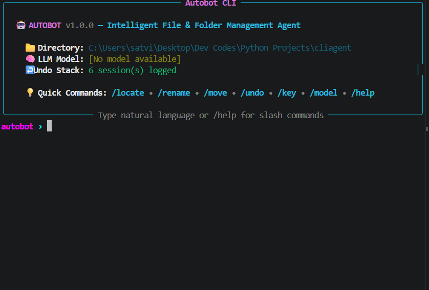

# 🤖 Autobot — Intelligent File & Folder Management CLI Agent

[](LICENSE)
[](https://www.python.org/downloads/)
[]()

`Autobot` is an intelligent, cross-platform Command Line Interface (CLI) agent built in Python for locating, renaming, and moving files/folders across directory trees. It features a **persistent interactive REPL shell**, **tab auto-completion**, **deterministic slash commands (`/`)**, **rich dry-run preview action cards**, **transaction history undo logs**, and **optional natural language AI processing** powered by Local LLMs (Gemma 4B / Qwen 4B) or universal Cloud LLMs (OpenAI, Groq, OpenRouter, DeepSeek, etc.).

---



---

> [!NOTE]
> ### 💡 AI is 100% Optional
> Autobot is a complete, self-contained, and deterministic CLI file manager out of the box. All core features—including the interactive REPL shell, slash commands (`/locate`, `/rename`, `/move`), CLI subcommands, wildcard glob matching, bulk pattern renames, dry-run safety cards, transaction history, and `/undo`—work completely offline with **zero LLMs, zero API keys, and zero cloud dependencies**.
>
> The AI engine is purely an **opt-in capability** for translating plain English instructions (e.g., *"move all invoice PDFs from Downloads to Finance"*) using local Ollama / LM Studio models or cloud providers. When no AI is configured, Autobot runs at full speed in deterministic mode.

---

## 🌟 Key Features

* **🔄 Persistent REPL Shell (`autobot › `)**: Continuous terminal session powered by `prompt_toolkit`. Remembers active workspace, model provider, and undo history across inputs.
* **⚡ Tab Auto-Completion**: Context-aware completion for slash commands (`/lo` ➜ `/locate`, `/mo` ➜ `/move`, `/hi` ➜ `/history`) and local filesystem paths.
* **🎨 CLI Theme**: Terminal styling with rounded box borders (`box.ROUNDED`), Cyan/Magenta/Slate color palette, and live session status badges.
* **⚡ Deterministic Slash Commands**: Zero-latency commands (`/locate`, `/rename`, `/move`, `/undo`, `/history`, `/cd`, `/key`, `/model`, `/models`, `/status`, `/help`, `/clear`, `/exit`).
* **🔍 Hybrid Search Engine (Wildcard Glob + RapidFuzz)**: Precision `fnmatch` wildcard glob matching (`*.png`, `*invoice*`, `doc_??.pdf`) with 100% precision score, combined with RapidFuzz fuzzy similarity scoring for natural typos (`invoce` ➜ `annual_invoice_2024.pdf`).
* **✏️ Single & Bulk Pattern Renaming**: Rename individual items or apply pattern transformations (`snake_case`, `kebab-case`, `camelCase`, `title_case`, prefix/suffix, sequence numbering `01`, `02` with dynamic padding).
* **🔤 Safe Case-Preserving Renaming**: Safely handles case-only renames (`readme.md` ➜ `README.md`) on case-insensitive filesystems (Windows NTFS/FAT, macOS) using an atomic two-step temporary rename without false collision errors.
* **🚚 Cross-Volume Safe Relocation**: Moves files seamlessly across drives and partitions with `shutil.move`. Verifies target directories before moving; if missing, interactively prompts the user (`Create destination directory? [y/N]`).
* **🛑 Recursion & Collision Prevention**: Prevents moving a directory into itself or its subdirectories (`INVALID_MOVE`), and skips existing destination targets to prevent silent file overwrites (`COLLISION`).
* **📇 Action Cards & InquirerPy Confirmations**: Displays formatted Rich preview cards and interactive arrow-key confirmation menus (`[✓] Execute actions now` vs `[✖] Cancel operation`) before modifying disk. Supports `--yes` / `-y` flag for automated scripting.
* **↩️ Transaction History & Undo Subsystem (`/undo`, `/history`)**: Logs every file operation to `~/.autobot/history.json`. Review past transactions with `/history` and reverse the last batch with `/undo`, even across different Windows drive letters. Retains un-reversed actions during partial undos.
* **⏳ Live Animated Spinners**: Renders Rich animated spinners (`⠋ Searching directory tree...`, `⠙ AI parsing request...`) for fluid visual feedback.
* **🤖 Optional Dual AI Engine (Local Ollama Auto-Discovery & Cloud BYOK)**:
  - **Local Models**: Automatically queries `/v1/models` from local Ollama or LM Studio to auto-detect installed models (`qwen3.5:4b`, `gemma4`, `llama3`). Switch dynamically with `/model list` and `/model <name>`.
  - **Cloud Models**: Bring-Your-Own-Key (BYOK) for any OpenAI-compatible provider (OpenAI, Groq, OpenRouter, DeepSeek, Mistral, Together, etc.) with `/key <API_KEY>` and persistent configuration in `~/.autobot/config.json`.
  - **Zero Assumptions**: Displays `[No model available]` cleanly until an AI engine is configured or detected.

---

## 🚀 Quick Start & Installation

### 1. Prerequisites
* Python 3.10 or higher installed on your system.

### 2. Install Autobot
Clone the repository and install Autobot in editable mode:

```bash
git clone https://github.com/0carespal/cliagent.git
cd cliagent
python -m pip install -e .
```

*(This registers the `autobot` and `cliagent` commands in your system PATH so you can launch it from **any terminal folder**).*

---

## 💻 3 Ways to Use Autobot

### Method 1: Global Interactive REPL (Recommended)
Open PowerShell, CMD, or Bash in **any folder** on your computer (e.g. `Downloads`, `Documents`, or `Desktop`) and run:

```bash
autobot
```

Autobot launches with that directory set as your active workspace!

*(Alternatively, without installing globally, run `python main.py` from the project directory).*

#### 📂 Navigating Folders Inside REPL
* **Switch directories on the fly**: Type `/cd <path>` (e.g. `/cd "$HOME/Downloads"` or `/cd ~/Documents`).
* **Smart path aliases**: Use standard folder aliases like `Downloads`, `Documents`, `Desktop`, `Pictures` directly.
* **Specify root directory in commands**: Pass `--start-dir <path>` to search external paths without leaving your current workspace.

---

### Method 2: Direct Terminal CLI Subcommands
Run deterministic commands directly from your terminal without entering the interactive shell:

```powershell
# Locate files with wildcards in Downloads
autobot locate "*.pdf" --start-dir "$HOME/Downloads"

# Move PNG images to Pictures folder
autobot move "*.png" "$HOME/Pictures" --start-dir "$HOME/Downloads"

# Case-preserving rename on Windows or macOS
autobot rename "readme.md" --new-name "README.md"

# Bulk rename with snake_case and dynamic sequence numbering (photo_01.jpg, photo_02.jpg)
autobot rename "*.jpg" --case snake --seq "photo_01" --start-dir "$HOME/Pictures"

# View past transaction batches
autobot history

# Reverse the last file transaction batch
autobot undo
```

---

### Method 3: Natural Language AI Assistant (Optional)
When connected to a local Ollama server or configured with a Cloud API key, type plain English sentences directly into the `autobot › ` prompt (or via `autobot ask "..."`):

```text
autobot › find all PNG files in Downloads and move them to Pictures/Screenshots
autobot › rename draft_document.txt to annual_report_2024.txt
autobot › move all reports larger than 10MB to Archive
```

Autobot analyzes your request, generates a dry-run preview card, and asks for confirmation before executing.

---

## 🎯 Slash Command Cheat-Sheet

| Slash Command | Description | Example Usage |
| :--- | :--- | :--- |
| **`/locate`** | Locates files/folders matching wildcards or fuzzy query | `/locate "*.pdf"` or `/locate "report" --start-dir "$HOME/Downloads"` |
| **`/rename`** | Renames files/folders (supports bulk, casing, & sequences) | `/rename "readme.md" "README.md"` or `/rename "*.jpg" --case snake --seq "img_01"` |
| **`/move`** | Moves matching files/folders to a target directory | `/move "*.png" "./Pictures"` or `/move "*.csv" "$HOME/Documents" --start-dir "./data"` |
| **`/cd`** | Switches current active workspace directory | `/cd "$HOME/Downloads"` or `/cd "Documents"` |
| **`/history`** | Displays past file transaction sessions and statuses | `/history` |
| **`/undo`** | Reverses the last move or rename transaction session | `/undo` |
| **`/key`** | Views or configures your Cloud LLM API key | `/key sk-proj-...` |
| **`/model list`** (or **`/models`**) | Lists all detected local Ollama models and cloud model status | `/model list` |
| **`/model <name>`** | Switches active LLM model (e.g. `qwen3.5:4b`, `gemma4`, `cloud`) | `/model qwen3.5:4b` or `/model cloud` |
| **`/status`** | Displays a summary card of active folder, model, and undo stack | `/status` |
| **`/help`** | Displays the interactive command cheat-sheet card | `/help` |
| **`/clear`** (or **`/cls`**) | Clears the terminal screen canvas | `/clear` |
| **`/exit`** (or `exit`, `quit`) | Exits the Autobot REPL session | `/exit` |

---

## 🛡️ Safety, Guardrails & Limitations

Because Autobot moves and renames files on your computer, safety guardrails are baked into every layer:

* **🔍 Automatic Directory Pruning**: Recursive search automatically skips system, cache, and dependency folders (`.git`, `node_modules`, `__pycache__`, `venv`, `AppData`, `$Recycle.Bin`, `System Volume Information`, `tmp`, etc.). Your system files and code repositories are never touched.
* **🛑 Collision Protection**: Before moving or renaming, Autobot verifies whether the destination file already exists. If a conflict is found, the action is flagged as `COLLISION` and **skipped**—it will never silently overwrite your existing files.
* **🔤 Safe Case-Only Renaming**: Changing letter casing on case-insensitive filesystems (Windows NTFS, macOS APFS) such as `file.txt` ➜ `FILE.TXT` is performed via an atomic two-step temporary rename to prevent operating system collisions.
* **🚫 Directory Recursion Guard**: Autobot detects and prevents attempts to move a directory into itself or one of its child subdirectories (`INVALID_MOVE`).
* **📁 Missing Target Directory Verification**: If a target destination folder does not exist, Autobot will never create it automatically; it pauses and prompts for explicit user consent (`Create destination directory? [y/N]`).
* **📇 Interactive Action Cards (Dry-Run by Default)**: All operations present a formatted Rich preview table detailing the source path, destination path, and validation status before prompting for confirmation (`[✓] Execute actions now` vs `[✖] Cancel operation`). For scripts, use `-y` or `--yes` to proceed without confirmation.
* **↩️ Reversible Transactions (`~/.autobot/history.json`)**: Every executed batch logs its inverse operation. Running `/undo` restores files to their original locations and names. If any file in a batch cannot be restored, un-reversed records are retained for safety.
* **💡 Best Practice**: When testing new complex wildcards or bulk patterns for the first time, try them on a sample test folder or review the dry-run action card carefully before confirming execution.

---

## 🤖 AI Engine Setup (Optional)

### 1. Offline Local LLMs (Ollama / LM Studio)
Run natural language commands 100% offline:

1. Install and run [Ollama](https://ollama.ai) or LM Studio.
2. Pull your preferred model (e.g., `qwen3.5:4b` or `gemma4`):

```bash
ollama run qwen3.5:4b
```

3. Autobot automatically connects to `http://localhost:11434/v1` and auto-discovers your local models!

### 2. Universal Cloud LLMs (BYOK — Bring Your Own Key)
Use any OpenAI-compatible provider (OpenAI, Groq, OpenRouter, DeepSeek, Mistral, Together, etc.).

#### Option A: Inside the Interactive REPL
Configure your key directly in the shell (automatically persisted to `~/.autobot/config.json`):

```text
autobot › /key sk-your-api-key-here
```

#### Option B: Via Environment Variables

**Windows PowerShell**:

```powershell
$env:LLM_API_KEY="your-api-key-here"
$env:LLM_MODEL="gpt-4o-mini"            # Optional: defaults to gpt-4o-mini
$env:LLM_BASE_URL="https://api.openai.com/v1"  # Optional: Groq / OpenRouter / etc.
```

**Linux / macOS / Bash**:

```bash
export LLM_API_KEY="your-api-key-here"
export LLM_MODEL="gpt-4o-mini"
export LLM_BASE_URL="https://api.openai.com/v1"
```

---

## 🧪 Running Automated Integration Tests

Run the full end-to-end integration test suite:

```bash
python tests/test_autobot.py
```

---

## 📁 Project Architecture

```text
cliagent/
├── assets/
│   └── demo.png          # REPL terminal screenshot preview
├── config.py             # System configuration, ignored folders, and LLM endpoints
├── main.py               # Main CLI launcher & Typer subcommand entry point
├── setup.py              # Packaging configuration & console_scripts registration
│
├── core/
│   ├── finder.py         # Recursive walker, fnmatch glob, rapidfuzz fuzzy search
│   ├── renamer.py        # Single/bulk rename, pattern replacement, & case converters
│   ├── mover.py          # Safe file relocation, recursion guard & directory verification
│   ├── safety.py         # Rich preview table renderer & JSON transaction undo log
│   └── slash_commands.py # Quote-aware shlex parser & slash command router
│
├── ai/
│   ├── base.py           # System prompts & JSON response sanitization
│   ├── local_llm.py      # Ollama / LM Studio (Gemma/Qwen) HTTP client
│   ├── cloud_llm.py      # Universal Cloud LLM client (OpenAI, Groq, OpenRouter, etc.)
│   └── intent_parser.py  # Unified AI provider router & intent extractor
│
├── ui/
│   ├── theme.py          # Antigravity CLI palette, Option A box banner & status spinners
│   ├── repl.py           # Persistent REPL prompt loop with tab completion
│   ├── tables.py         # Rich search result and history formatting tables
│   └── interactive.py    # InquirerPy interactive confirmation selection dialogs
│
└── tests/
    └── test_autobot.py   # End-to-end automated integration test suite
```

---

## 📄 License

This project is licensed under the [MIT License](LICENSE).
